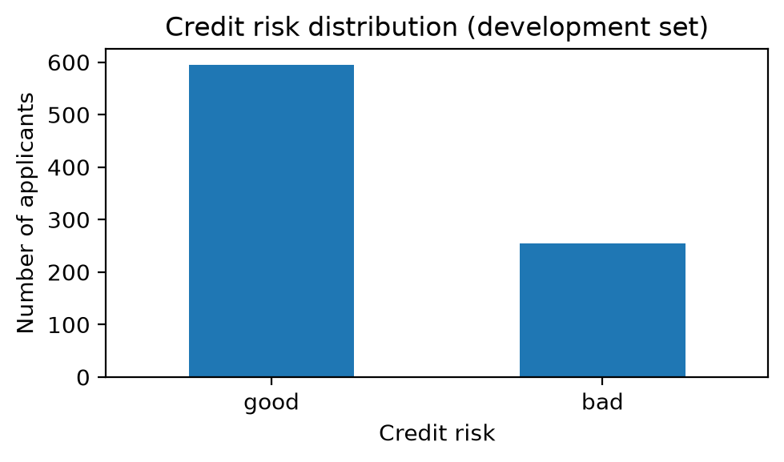
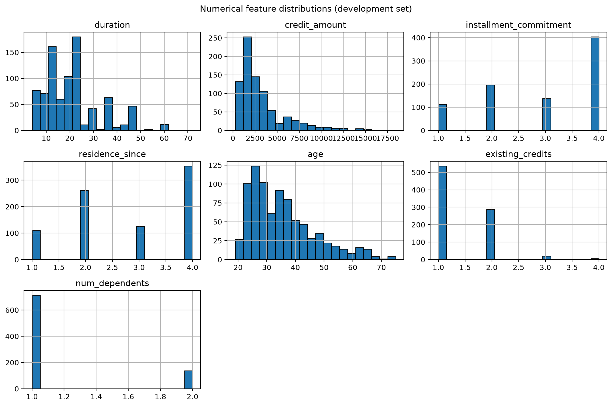
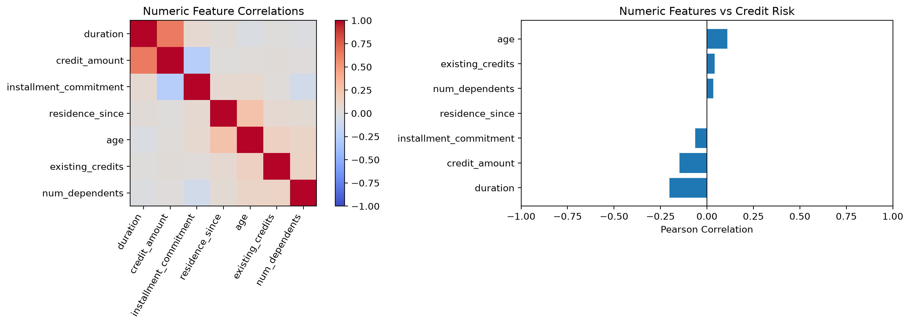
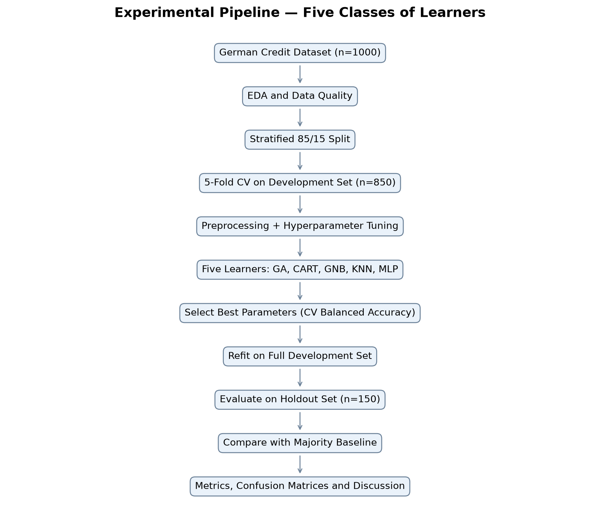
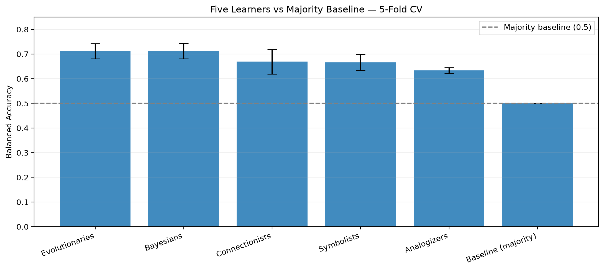
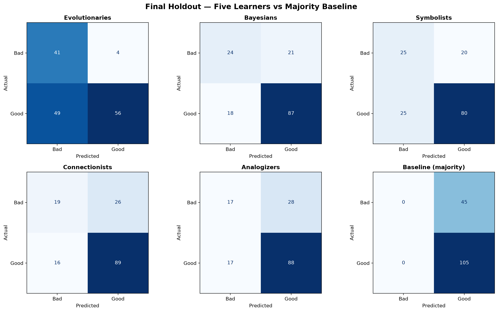
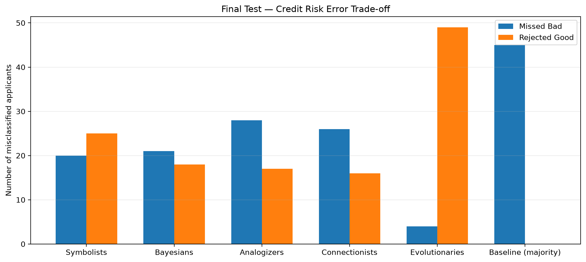
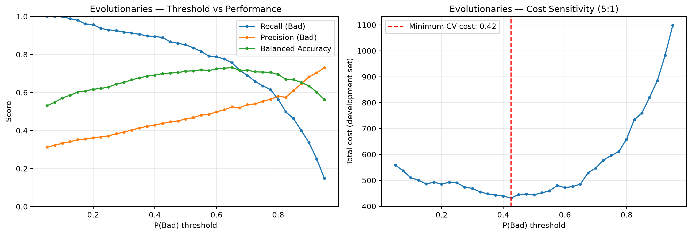
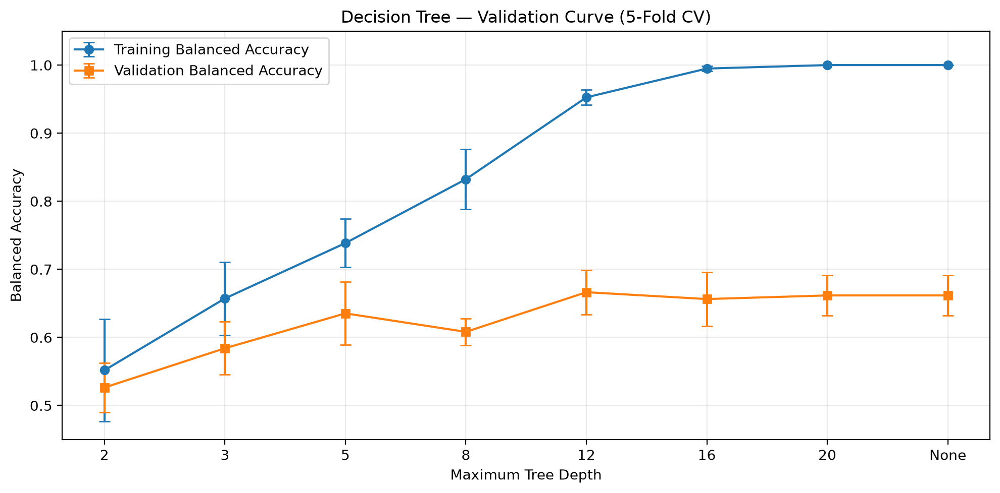

# Project 1 — The Five Classes of Learners

## 1. Identification

- **Student:** Yevhen Yefimov
- **Student number:** 138857
- **Course:** 41010-FAA
- **Institution:** University of Aveiro
- **Date:** November 2026
- **Dataset:** German Credit (`datasets/german_credit.csv.zst`)
- **Task:** Binary classification of credit risk (Bad = 0, Good = 1)

## 2. Models

This project compares one representative algorithm from each of Pedro Domingos' five classes of learners, under a shared experimental protocol.

| Learning class | Algorithm | Rationale | Hyperparameters investigated |
|---|---|---|---|
| Symbolists | Decision Tree (CART) | Interpretable, rule-based partitions; captures nonlinear interactions | `max_depth`, `min_samples_leaf`, `ccp_alpha` |
| Connectionists | Multi-Layer Perceptron (MLP) | Learns nonlinear relationships through a neural network | hidden layers, regularization `alpha`, learning rate, activation |
| Evolutionaries | Genetic Algorithm optimizing a linear classifier | Evolves model weights and bias directly, rather than using gradient-based training | generations, population size, weight and bias bounds |
| Bayesians | Gaussian Naive Bayes | Probabilistic, fast baseline with conditional-independence assumptions | `var_smoothing` |
| Analogizers | K-Nearest Neighbors (KNN) | Predicts from similarity to previously observed applicants | `n_neighbors`, weighting, distance metric |

**Model selection and tuning.** All five learners were tuned using stratified 5-fold cross-validation, selecting configurations by mean Balanced Accuracy.

- **Symbolists:** Decision Tree, depth 12, `min_samples_leaf=1`, `ccp_alpha=0`.
- **Connectionists:** MLP (16 neurons, ReLU, `alpha=0.001`, learning rate 0.01).
- **Evolutionaries:** Genetic Algorithm (200 generations, population 80, weight bound 2.0, bias bound 2.5).
- **Bayesians:** Gaussian NB (`var_smoothing=0.1`).
- **Analogizers:** KNN (3 neighbors, distance weighting, Euclidean distance).

The best CV Balanced Accuracy was **0.712** for both Evolutionaries and Bayesians, followed by Connectionists (0.669), Symbolists (0.666), and Analogizers (0.633).

The Genetic Algorithm directly learns model weights and bias through evolution, rather than merely tuning hyperparameters. It was also the most computationally expensive learner (approximately 48 seconds for tuning), while the other learners required substantially less time.

Full search grids, validation results, and computational costs are documented in the notebook.
## 3. Dataset

### 3.1 Choice and motivation


I chose the German Credit dataset primarily because of my personal interest in financial systems and financial technology. When I saw the dataset among the available options, it immediately caught my attention, as credit risk assessment is closely related to the financial domain that interests me.

Beyond this initial motivation, the dataset turned out to be particularly suitable for comparing the five classes of learners. It combines numerical and categorical features, has an imbalanced target distribution (70% Good, 30% Bad), and introduces asymmetric misclassification costs (5:1).

These characteristics make the experiment more meaningful than a simple accuracy comparison. They allow me to investigate how different learning paradigms handle risk, what kinds of errors they make, and how those errors translate into practical financial decisions.

### 3.2 Data source and structure

- Source: course-provided German Credit dataset (`datasets/german_credit.csv.zst`).
- Observations: 1,000; features: 20 (7 numeric, 13 categorical in the notebook).
- Target: `Bad = 0`, `Good = 1`.
- Missing values: none observed in the development set.
- Limitations: The dataset contains only 1,000 observations, which limits statistical reliability and generalization. Its age and potentially outdated credit patterns may reduce representativeness for modern lending. Categorical encoding and possible demographic biases may also affect model performance and fairness.

### 3.3 Exploratory Analysis

Exploratory Data Analysis (EDA) was performed on the development set only, before model training and evaluation. The objective was to understand the class distribution, feature characteristics, and relationships within the data, and to use these observations to inform the experimental methodology.

#### Class Distribution



*Figure 1. Distribution of Good and Bad credit applicants in the development set.*

The target variable is imbalanced, with approximately **70% Good Credit** and **30% Bad Credit** applicants.

This imbalance is important because a classifier that always predicts Good Credit would achieve approximately 70% accuracy without identifying a single high-risk applicant.

**Methodological implication:** Balanced Accuracy was selected as the primary comparison metric, supported by class-specific Precision, Recall, F1-score, and confusion matrices. A majority-class classifier was also included as a baseline.

#### Numerical Feature Distributions



*Figure 2. Distributions of the seven numerical features in the development set.*

The dataset contains **7 numerical features and 13 categorical features**, with no missing values.

The numerical features show different distributional characteristics:

- **Credit amount** has a strongly right-skewed distribution, with most loans concentrated at lower amounts and a small number of substantially larger loans.
- **Credit duration** is concentrated around shorter repayment periods, with fewer observations representing long-term loans.
- **Age** is also right-skewed, with most applicants concentrated in younger and middle age groups.
- **Installment commitment, residence duration, existing credits, and number of dependents** take a limited number of discrete values.

These observations indicate substantial differences in feature scales and the presence of potentially influential extreme values.

**Methodological implication:** Numerical scaling was included in the preprocessing pipeline, particularly to support distance-based learning (KNN) and neural-network optimization (MLP). Preprocessing parameters were fitted exclusively on the training portion of each cross-validation fold to prevent data leakage.

#### Numerical Correlations and Relationships with Credit Risk



*Figure 3. Pearson correlations among numerical features (left) and between individual numerical features and the target variable (right).*

The correlation analysis reveals several patterns:

- **Credit duration and credit amount** have a noticeable positive correlation, suggesting that larger loans are often associated with longer repayment periods.
- **Credit duration and credit amount** are negatively correlated with the Good Credit target, indicating an association between larger or longer loans and higher credit risk.
- **Age** shows a relatively weak positive correlation with Good Credit.
- Most other numerical features exhibit weak linear correlations with the target.

Because the target is encoded as **Bad = 0** and **Good = 1**, a negative correlation indicates an association with the Bad Credit class.

The relatively weak individual correlations suggest that no single numerical feature provides a complete explanation of credit risk. However, this does not rule out useful nonlinear relationships, feature interactions, or predictive information in categorical variables.

**Methodological implication:** These findings support comparing learners with different inductive biases, including decision rules, neural networks, evolutionary optimization, probabilistic assumptions, and distance-based similarity.

#### EDA Summary

The exploratory analysis identified three important characteristics of the dataset: class imbalance, heterogeneous feature distributions, and relatively weak individual linear relationships with the target.

These observations influenced the choice of evaluation metrics, preprocessing strategy, and model comparison methodology. In particular, the combination of class imbalance and asymmetric misclassification costs makes it important to evaluate not only overall predictive performance but also the consequences of different classification errors.

### 3.4 Theoretical Expectations and Model Assumptions

No formal hypotheses were documented before running the experiments. Therefore, the following expectations are based on the theoretical properties of each learning paradigm and should not be interpreted as pre-registered predictions.

| Learner | Theoretical expectation | Reason |
|---|---|---|
| Symbolists (Decision Tree) | Moderate | Can capture nonlinear relationships and feature interactions, but may overfit a relatively small dataset. |
| Connectionists (MLP) | Moderate | Can learn complex nonlinear patterns, but may be sensitive to the limited sample size and hyperparameters. |
| Evolutionaries (Genetic Algorithm) | Uncertain | Can directly optimize a cost-sensitive objective, but performance depends on the model representation and evolutionary search. |
| Bayesians (Gaussian NB) | Moderate | Simple and computationally efficient, but conditional independence and distributional assumptions may be restrictive. |
| Analogizers (KNN) | Moderate to low | Distance-based learning may struggle with mixed feature types and high-dimensional encoded data. |

These expectations provide a theoretical framework for interpreting the experimental results rather than predictions established before the experiments.

## 4. Methodology

### 4.1 Experimental Pipeline



*Figure 4. Experimental pipeline for comparing the five classes of learners.*

The experiment begins with the German Credit dataset, followed by exploratory data analysis and data quality checks. A stratified 85/15 split separates the development data from the final holdout set.

The development set is used for five-fold stratified cross-validation, preprocessing, hyperparameter tuning, and model selection. Preprocessing is fitted independently within each training fold to prevent data leakage.

The selected configurations are then retrained on the complete development set and evaluated on the final holdout set. All five learners follow the same evaluation protocol to ensure a consistent comparison.

### 4.2 Splitting and validation

A stratified 85% development / 15% holdout split produces 850 development and 150 holdout observations. Hyperparameters are selected using identical stratified 5-fold cross-validation splits on development data, with `SEED = 42`. Preprocessing is fitted on each training fold only.

### 4.3 Preprocessing

A common preprocessing pipeline was applied to all five learners:

Numerical features: median imputation and StandardScaler.

Categorical features: most-frequent imputation and OneHotEncoder.

Missing values: none observed, but imputation was retained for robustness.

Data leakage prevention: preprocessing was fitted only on training data within each CV fold. For final evaluation, it was refitted on the full development set.

This approach ensures consistent model comparison and prevents information leakage from validation and test data.

### 4.4 Metrics and baseline

**Primary metric:** Balanced Accuracy, because the class distribution is imbalanced. Additional metrics: Accuracy, Precision/Recall/F1 for Bad Credit (class 0), confusion matrices, fit time, and cost-sensitive errors. Compare against a majority-class baseline; report CV means and standard deviations to assess stability.

### 4.5 Hyperparameter search and computation

All five learners were tuned using 5-fold stratified cross-validation on the development set. Multiple hyperparameter configurations were evaluated using Balanced Accuracy, and the best configuration was selected based on mean CV performance.

The search included model complexity, regularization, neighborhood size, and evolutionary algorithm parameters, depending on the learner.

Training times were recorded to compare computational costs. Random seeds were fixed for reproducibility, and the final holdout set was excluded from tuning.

### 4.6 Leakage and reproducibility

All fitting and tuning use development data. The holdout was inspected during preliminary experiments, so its final evaluation cannot be described as fully independent of the development process; this limitation is acknowledged rather than claiming a sealed test set.

## 5. Evaluation and Conclusion

### 5.1 Cross-validation Comparison



*Figure 5. Mean Balanced Accuracy ± standard deviation across five stratified CV folds.*

Evolutionaries and Bayesians achieved the highest mean Balanced Accuracy (**0.712**), followed by Connectionists (0.669), Symbolists (0.666), and Analogizers (0.633). All five learners outperformed the majority baseline (0.500).

The overlapping variability ranges indicate that the small differences between the leading models should not be interpreted as conclusive evidence of superiority.

### 5.2 Final holdout results

| Learner | Accuracy | Balanced Accuracy | Precision (Bad) | Recall (Bad) | F1 (Bad) |
|---|---:|---:|---:|---:|---:|
| Evolutionaries | 0.6467 | 0.7222 | 0.4556 | 0.9111 | 0.6074 |
| Bayesians | 0.7400 | 0.6810 | 0.5714 | 0.5333 | 0.5517 |
| Symbolists | 0.7000 | 0.6587 | 0.5000 | 0.5556 | 0.5263 |
| Connectionists | 0.7200 | 0.6349 | 0.5429 | 0.4222 | 0.4750 |
| Analogizers | 0.7000 | 0.6079 | 0.5000 | 0.3778 | 0.4304 |
| Majority baseline | 0.7000 | 0.5000 | 0.0000 | 0.0000 | 0.0000 |

### 5.3 Error Trade-offs and Diagnostic Plots



*Figure 7. Confusion matrices for the five learners and majority baseline.*



*Figure 8. Missed Bad Credit applicants versus incorrectly rejected Good Credit applicants.*



*Figure 9. Evolutionary classifier performance and misclassification cost across decision thresholds.*

Evolutionaries identified **41 of 45 Bad Credit applicants**, missing only 4, but incorrectly rejected 49 Good Credit applicants.

Under the assumed **5:1 cost ratio**, its total holdout misclassification cost was **69**, compared with **225** for the majority baseline.

Development-set threshold analysis found the lowest evaluated cost at **0.425**, demonstrating that the preferred decision threshold depends on business costs rather than accuracy alone. The final holdout predictions were not changed based on this analysis.

### 5.4 Validation Curve and Hyperparameter Sensitivity



*Figure 10. Training and cross-validation Balanced Accuracy across different Decision Tree depths.*

Training performance increases with tree depth, while cross-validation performance improves initially and then stabilizes or declines. This indicates overfitting in deeper trees.

The results demonstrate why hyperparameter tuning is necessary: greater model complexity does not necessarily improve generalization.

### 5.5 Theoretical Expectations Revisited

The results were broadly consistent with the theoretical characteristics discussed in Section 3.4.

- **Symbolists:** Moderate performance (CV 0.666), with deeper trees showing signs of overfitting.
- **Connectionists:** Moderate performance (0.669), suggesting limited benefits from additional model complexity on this dataset.
- **Evolutionaries:** Strong performance (0.712), particularly in identifying Bad Credit applicants under cost-sensitive training.
- **Bayesians:** Strong performance (0.712), despite the simplifying assumptions of Gaussian Naive Bayes.
- **Analogizers:** Lowest performance among the five learners (0.633), consistent with the challenges of distance-based learning on mixed, encoded features.

Overall, the experiment demonstrates that more complex learners do not necessarily outperform simpler probabilistic models. These interpretations are retrospective rather than confirmations of pre-registered hypotheses.

### 5.6 Limitations and Next Steps

The main limitations are the small dataset (1,000 observations), a single holdout split, and uncertainty in model performance. Previous holdout inspection may introduce bias, while the fixed random seed does not capture variability in the Genetic Algorithm.

The assumed 5:1 error-cost ratio and common preprocessing strategy may also influence the results.

Future work could include repeated cross-validation, testing GA stability across multiple seeds, alternative preprocessing, cost sensitivity analysis, and fairness evaluation across demographic groups.

### 5.7 Conclusion

The experiment showed that different learning paradigms respond differently to the characteristics of the German Credit dataset.

Evolutionaries performed well in identifying high-risk applicants, benefiting from cost-sensitive optimization, but at the expense of more false rejections. Bayesians achieved comparable cross-validation performance with much lower computational cost, demonstrating the effectiveness of simpler models.

Decision Trees showed overfitting at greater depths, while KNN struggled with mixed, encoded features. Overall, the results highlight that model selection should consider **error costs, generalization, and computational efficiency**, rather than accuracy alone.

## Reproducibility

Follow these steps to reproduce the project results.

### 1. Set up the environment

Open a terminal in the project root directory and run:

```bash
make venv
```

This creates a Python 3.12 virtual environment in `venv/` and installs all required dependencies from `requirements.txt`.

### 2. Select the Jupyter kernel

Open `notebooks/five_classes.ipynb` in VS Code.

1. Click **Select Kernel** in the top-right corner.
2. Select **Python Environments**.
3. Choose **venv (Python 3.12)** — `venv/bin/python`.

### 3. Restart the kernel

In the Jupyter Notebook toolbar, click **Restart Kernel** to ensure the selected environment is loaded.

### 4. Run the notebook

Click **Run All** to execute all cells sequentially.

The notebook will reproduce the analyses, visualizations, and results for the five classes of learners.

### 5. Generated outputs

Exported figures are saved in the `outputs/` directory.

The notebook can be executed again using the same steps without manually installing additional dependencies.